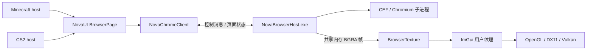

# ClickGUI 内嵌 Chromium 浏览器架构设计

状态：初始设计及首版实施记录。日期：2026-09-27。

首版已实现自带 CEF、Browser 页面、多标签、网页交互、IME 桥、共享纹理及单文件注入器内嵌包。
实际代码和构建说明见 `Client/src/chrome/README.md`。下文保留初始设计；实施采用完整帧 mailbox
替代三缓冲、采用官方 bootstrap 宿主、使用独立 settings.ini。OpenGL 与 DX11 的原生测试已通过，
Vulkan 游戏内表现仍待验证；下载/上传管理、GPU 零拷贝等不在本次交付中。

目标：在 ClickGUI 左侧增加与 MODULES、CLIENT 同级的 BROWSER 分组标题，下面提供与 Combat、Settings 同级的 Chrome 导航项。用户可以在游戏内输入网址、浏览网页、滚动、点击和输入文字。浏览器与 Minecraft、CS2 独立，两个游戏只提供窗口、输入和渲染生命周期。

本文基于当前本地项目接口设计；CEF 的发行版本、接口签名和运行时文件清单须在实施时按选定 SDK 核对，不代表已完成兼容验证。

## 1. 产品布局

```text
MODULES
  Combat
  Movement
  Player
  Render
  Miscellaneous

CLIENT
  Settings

BROWSER
  Chrome           ← 新导航项，与 Combat、Settings 同级
```

Chrome 进入独立内容页面，不挤进模块的两列参数卡片。进入页面自动启动浏览器，固定两行顶栏分别显示标签和地址工具栏；设置复用 Panel 的属性控件与弹窗。电源按钮可停止或重新启动浏览器：

```text
┌─ Chrome ───────────────────────────── 设置齿轮 ─┐
│ 标签页标题 ×    +                              │
│ ←  →  刷新   [网址 / 搜索内容             ]   ↗ │
├───────────────────────────────────────────────┤
│                                               │
│                 可交互网页                    │
│                                               │
└───────────────────────────────────────────────┘
```

- Chrome 是产品入口名称，底层为 CEF/Chromium；不嵌入桌面 Google Chrome 窗口，也不承诺 Google Chrome 账号同步、扩展商店或 DRM 能力。
- 第一阶段单标签可用，接口从开始携带 TabId；多标签在第二阶段开放，默认最多 4 个。
- 浏览器工具栏使用现有 Panel 字体、圆角、淡色悬停反馈、主题与动画。网页保持站点自身样式，不强制修改网页 CSS。
- 外框与设置弹窗复用现有 Blur；网页内容不做背景模糊，避免文字和视频模糊。
- `↗` 表示在 ClickGUI 内扩大网页区域，隐藏模块搜索工具栏、利用右侧全部内容区；不是网页主动请求独占游戏窗口。
- 当前 Panel 基础尺寸是 748×576，普通内容区约 590×520。首版保持整体布局，通过浏览器区域扩大和网页缩放改善窄页面阅读；不能把桌面 1920 宽网页缩成一张不可读的小图。
- Browser 页隐藏模块搜索框，地址栏负责网址/网页搜索。切回模块页恢复原搜索逻辑。导航与页面缓存都需要认识 BrowserPage，避免回落成模块列表。
- 开关语义分开：打开/关闭浏览器管理服务生命周期；关闭 ClickGUI 仅隐藏网页，不默认销毁标签和登录状态。

## 2. 技术选择

推荐 **CEF + windowless/off-screen rendering（OSR）+ 独立浏览器宿主进程**。

| 方案 | 适配情况 | 决策 |
| --- | --- | --- |
| CEF OSR | 可取网页像素、转发输入、统一接入 OpenGL/DX11/Vulkan；需要运行时资源和子进程 | 采用 |
| WebView2 | Chromium 系，系统运行时体积负担较小；组合与输入更偏 Windows/DX，跨当前三后端需要额外验证 | 备选，首版不混用 |
| 将 Chrome HWND 嵌入游戏 | 难以配合 ImGui 裁剪、动画、全屏和渲染后端 | 不采用 |
| 在注入 DLL 内初始化 CEF | 与反射加载、静态 TLS 检查、卸载及浏览器进程主循环耦合 | 不采用 |

独立宿主是正常启动的原生 C++ EXE，在自己的进程入口执行 CEF 初始化和子进程分发。注入 DLL 只包含轻量客户端、IPC 与纹理适配，**不链接 libcef、不在 DllMain 启动 Chromium**。CEF 还会创建 renderer/GPU 等进程；独立宿主不意味着只有一个浏览器进程。

## 3. 边界与依赖



依赖方向：

- `chrome` 核心不包含 Minecraft/JNI、CS2 SDK、游戏实体或模块头文件。
- `ui/clickgui/browser` 依赖浏览器公共接口，负责绘制、焦点与页面布局，不包含 CEF 头文件。
- `chrome/host` 是唯一包含 CEF API 的目标。
- `config` 存储通用设置，浏览器站点数据单独管理；切换战斗配置不重置登录态。
- `bind` 与窗口输入桥提供输入拦截。游戏分支不各写一套 Browser。
- SMTC 保持原来的服务边界；网页声音先使用浏览器标准音频输出，不自动注册新的 SMTC 会话，不抢网易云的选中来源。

## 4. 目录及构建目标

用户指定的 `Client/src/chrome` 作为整个浏览器子系统根目录：

```text
Client/src/chrome/
  CMakeLists.txt
  BrowserService.h              公共命令 / 状态快照 / 生命周期
  BrowserTypes.h                TabId、输入、视口、加载状态
  client/
    BrowserService.cpp          轻量客户端，不链接 CEF
    HostProcess.cpp             启动、健康检测、退出
    FrameConsumer.cpp           接收共享内存帧
  ipc/
    Protocol.h                  协议版本、消息、长度和数量限制
    ControlChannel.cpp          异步控制通道
    SharedFrames.cpp            帧缓冲所有权和代际切换
  host/
    Main.cpp                    正常 EXE 入口，CEF 初始化/子进程入口
    CefApplication.cpp
    BrowserClient.cpp           生命周期、导航、加载、弹窗回调
    OffscreenRenderer.cpp       OSR 主画面 / 弹出画面
    InputDispatcher.cpp         CEF UI 线程消费输入
    ProfileStore.cpp
  vendor/cef/
    README.md                   锁定的 SDK 版本、获取步骤和校验值
    ...                         实施时准备的 SDK，排除生成文件

Client/src/ui/clickgui/browser/
  BrowserPage.h/.cpp
  BrowserToolbar.h/.cpp
  BrowserInput.h/.cpp
  BrowserTexture.h/.cpp

Client/test/chrome/             无游戏浏览器宿主和 IPC 测试
Client/docs/chrome-browser-architecture.md
```

构建拆为 `NovaChromeClient` 静态库和 `NovaBrowserHost` EXE。只把前者链接到 NovaClientBase；CEF wrapper/runtime 只属于宿主。生产构建显式列源文件。现有顶层递归收集头文件须排除 `src/chrome/vendor`，避免 CEF 头文件全部混进 DLL 工程。

运行时二进制、缓存和 profile 不写到源码目录。`src/chrome/vendor/cef` 保存开发依赖；正式发布从构建产物生成带版本号的 runtime 包。

## 5. 与当前项目的实际接入点

| 现有文件/区域 | 计划改动 |
| --- | --- |
| `ui/clickgui/panel/PageLayout.h/.cpp` | 增加 BrowserPage 路由；Settings 下插入 Browser；为 Browser 跳过模块 choices/rebuild/card 路径 |
| `ui/clickgui/panel/TopBar.cpp` | Browser 页切换为浏览器标题/工具栏策略，停用模块搜索捕获 |
| `ui/clickgui/panel/PanelClickGui.cpp` | 复用主题、缩放、展开动画；将内容区域矩形交给 BrowserPage |
| `ui/hud/musichud/CoverTexture.cpp` | 参考现有 ImTextureData 注册、销毁和设备重建方式；浏览器另写高频纹理更新实现，不让 SMTC 封面类承担浏览器职责 |
| `ui/backend/Dx11Overlay.cpp`、Minecraft `host/render/OverlayHost.cpp` | 窗口事件转发、焦点优先级、UTF-16/IME；只做宿主适配 |
| `bind/InputManager.cpp` | 协调网页焦点与快捷键消费；现有 onChar(char) 不能承载完整中文输入，新增 Unicode 路径，不能直接截断 wchar_t |
| `ui/CMakeLists.txt`、`Client/CMakeLists.txt` | 注册浏览器 UI、客户端库与独立宿主目标 |
| 两个游戏的启动/卸载入口 | 注册通用服务；先停止浏览器输入与回调，再释放图形资源及 DLL |

当前 ImGui 纹理设施可以复用思路，但动态更新矩形、Vulkan 同步和设备丢失必须实测，不能因封面纹理可用就认定每帧网页纹理已被支持。

## 6. 服务、线程与 IPC

公共接口只暴露概念操作：`Start`、`CreateTab`、`Navigate`、`Back/Forward/Reload`、`SetViewport`、`SetVisibility`、`SendInput`、`Snapshot`、`AcquireLatestFrame`、`BeginShutdown`。状态包括标题、当前 URL、加载进度、前进后退可用性、错误、光标形状和焦点信息。

- 游戏渲染线程：读取不可变状态快照、上传新帧、绘制 ImGui；不等待进程启动、网页导航或管道回复。
- 窗口线程：保留 Win32 原始消息和 IME 数据，投递输入队列；不调用 CEF 或跨线程调用 ImGui。
- DLL 内 IPC 工作线程：发送命令、接收状态、监视宿主退出，不访问游戏对象。
- 浏览器宿主：CEF UI 线程创建/销毁浏览器并处理输入；OSR 回调发布帧。严格遵循选定 CEF 版本的线程约束，不在任意管道线程调用浏览器 API。

控制通道采用本机命名管道，帧采用共享内存。握手包含协议版本、宿主版本、实例随机标识；多个游戏实例分别启动独立宿主。管道限制当前用户访问，命令只包含浏览器操作，不暴露游戏读写接口。

所有消息有大小上限、TabId、序列号和视口代数；拒绝未知版本、非法尺寸、过长地址和溢出长度。输入队列满时可合并鼠标移动，不能随意丢 key-up；无法保留完整键状态时触发失焦并清空按下状态。

## 7. 网页画面与性能

首版选择 CPU OSR 的 BGRA8 帧，统一跨后端上传；先不依赖 Chromium GPU 共享句柄，因为它会增加 DX11 与 Vulkan/OpenGL 互操作差异。

传输采用 3 个共享帧槽，原子状态表示 Free/Writing/Ready/Reading。生产者只写空闲槽；消费者锁定最新 Ready 帧，完成本地复制后释放；无空位时跳过本次发布，不阻塞 CEF。不得在消费者读取时覆盖同一缓冲。

- 宿主维护完整 backing image，并应用 CEF dirty rect。首版每个发布槽包含完整一致快照，允许直接丢弃旧帧。
- 不能仅丢弃增量 dirty rect 帧，否则会丢失中间更新。第二阶段优化增量上传时，必须合并自已上传序号以来的脏区，缺帧/换尺寸退回整帧。
- BGRA → RGBA 通道转换或后端 swizzle 明确选一条；正确处理预乘 alpha。首版网页视口使用不透明背景，工具栏透明度由 Nova 控制。
- 纹理由 BrowserTexture 复用，只有尺寸变化或设备代数变化才重建。保留最新 CPU 帧，用于 F11、窗口改变、DX11 resize 和 Vulkan swapchain 重建。
- 尺寸变化使用新代数共享区握手，旧映射等待读者完成后回收；拒绝旧代数迟到帧。
- CEF 的 `PET_POPUP` 画面用于 HTML 下拉列表等，由独立弹出纹理/矩形合成，不能遗漏后导致网页控件看似无法使用。

建议默认参数：可见页 30 FPS，可调 15–60；隐藏页通知 CEF 隐藏并停止向游戏传帧，避免定时空上传。隐藏不代表 JS、音频或网络完全停止；另提供“后台音频”，默认关闭并在隐藏时静音。

视口按 Panel 实际像素生成，网页 zoom 与 GUI size 分开。首版将 backing buffer 限制在 1920×1080，超出时明确降低内部渲染比例并同步坐标映射。0 尺寸或最小化转为隐藏状态。

量级估算：1280×720 BGRA 单帧约 3.52 MiB，30 FPS 一次完整复制约 105 MiB/s；1920×1080 约 7.91 MiB/帧、237 MiB/s。进程间复制、颜色转换和 GPU 上传会产生多次读写，因此这些值不是总带宽，也不能承诺固定游戏 FPS 损失。Chromium 内存通常为数百 MB 量级，复杂网页和多标签会继续增加，以实际版本和网页测量为准。

## 8. 输入、焦点与中文

统一优先级：**已配置的熔断键 → Nova 模态弹窗/地址栏 → 网页 → 其他 ClickGUI 控件 → 游戏**。

- 点击网页才获取网页键盘焦点；点击导航、工具栏、地址栏或关闭 GUI 立即失焦。
- 网页输入期间拦截游戏模块快捷键、鼠标攻击与移动；不能只依赖 ImGui 的 WantCaptureKeyboard，因为网页纹理不是原生输入控件。
- 默认 ESC 关闭 ClickGUI；在 Nova 弹窗打开时先关闭弹窗。网页不能捕获熔断键。其他绑定作为网页文字输入时不触发模块。
- 鼠标坐标通过“屏幕 → 内容矩形 → 网页 DIP → backing 像素比例”转换；CEF 输入坐标与所选 SDK 的坐标约定统一。GUI 缩放、DPI 和网页 zoom 不能被重复乘算。
- 初次展开动画阶段沿用 Panel 禁止交互策略，避免画面动画位置与网页点击位置错位。切页、失焦、Alt-Tab 时清理按下状态并发送必要 release。
- 支持双击、滚轮/水平滚轮、拖动选择、前后侧键、光标变化、Ctrl+C/V/A、Ctrl+L、Ctrl+R；菜单输入不能重复投递到 ImGui 文本框和网页。
- 中文需要完整 Win32 IME 桥：composition start/update/end、候选窗位置、UTF-16 surrogate pairs；调用 CEF 对应 composition/commit 接口，处理候选位置回传。不能把 WM_CHAR 当成全部 IME 实现。

## 9. 网页行为及配置

Browser 设置齿轮内首版仅保留：主页、Browser FPS、网页缩放、后台音频。主页默认本地空白欢迎页，不强制访问外站。搜索文本编码后交给明确配置的搜索地址；默认 URL 输入支持 http/https，无 scheme 的域名补 https。

浏览器内部页面使用受控本地 scheme；地址栏默认不接受任意 `file:`、`javascript:` 或系统协议。网页 `window.open` 在标签能力就绪后转为新标签，首版转为当前页并提示；不弹出脱离游戏的 Chrome 窗口。

首版覆盖普通网页、登录、滚动、表单和链接。下载、上传、摄像头/麦克风、系统外链、网页全屏另做用户可见流程，未实现时明确提示，不静默调用外部程序。网页右键菜单由 CEF 菜单数据转为 Nova 风格菜单；文本选择等功能不可因为替换菜单丢失。

默认使用独立 browser profile，不读桌面 Chrome 的 cookie/用户目录。两个游戏进程同时运行时使用独立实例 profile，避免 Chromium profile 锁竞争；共享登录态属于后续独立设计。

建议目录（新增设计，实际按现有配置根目录解析）：

```text
%LOCALAPPDATA%/Nova/Browser/runtime/<cef-version>/  CEF 程序和资源
%LOCALAPPDATA%/Nova/Browser/profiles/<profile-id>/ cookie、缓存、站点存储
现有 Nova 配置根目录/browser.json                 浏览器通用设置
```

通用设置走 config 层新增专用配置对象；不把 cookie 或 profile 混进用户分享的 Minecraft/CS2 模块配置。退出时保留 profile，清理浏览数据是独立操作。

## 10. 打包、升级与单文件注入器

CEF 无法作为完整浏览器只塞进反射加载 DLL，正常运行需要宿主 EXE、libcef、数据包、locale 和相关库。准确清单由所选 CEF 发行包及其许可决定，不手写一个猜测列表。

可以继续保持用户看到的发布目录只有 `Injector.WinUI.exe`：

1. 构建阶段把锁定版本的浏览器 runtime 压缩包嵌入注入器资源。
2. 注入器准备/校验版本目录，使用临时目录解压，校验成功后原子发布；已在运行的版本不覆盖。
3. 通过通用启动配置把 runtime 位置提供给 DLL，DLL 不从工作目录猜测依赖路径。
4. 不使用浏览器时不启动进程；资源已准备也不意味着加载 CEF。

这保持的是**单文件分发**，运行后磁盘必然有解压文件；EXE 体积会明显变大。可选按需下载会减小注入器，但依赖网络，不能同时承诺离线首次可用。首版推荐离线内嵌包，是否改为下载由发布需求决定。

宿主采用正常 Windows 加载及 CEF 推荐的沙箱配置，不能为了启动方便默认 `--no-sandbox`。具体沙箱链接、子进程启动及 Job Object 的兼容性在独立宿主原型中验证；DLL 静态 TLS 限制不施加到这个正常启动的 EXE 上。

## 11. 关闭、熔断和错误恢复

生命周期：`Stopped → Starting → Ready → Stopping → Stopped`，错误转为 `Failed`。页面可显示启动中、缺少 runtime、页面加载失败、宿主崩溃，并允许显式重试。渲染循环不反复拉起失败宿主。

熔断顺序：停止接收输入/创建新命令 → 浏览器失焦 → 请求关闭标签 → 宿主等待 CEF 关闭回调 → CEF shutdown → IPC 线程退出 → 渲染线程回收纹理 → 注销所有回调 → 卸载 DLL。

正常关闭给宿主有限宽限时间，超时只终止本实例所属进程树。进程树 ownership 使用经过验证的 Job Object/等价机制；不能仅按 exe 名称杀进程。宿主检测父进程退出，游戏崩溃时也应退出。所有 DLL 内线程和回调退出是卸载前置条件，不能超时后留下线程继续执行已释放 DLL 代码。

F11/设备重建只更换图形资源，不重启浏览器、不丢登录态。宿主崩溃与 renderer 标签崩溃分开处理，先尝试单标签恢复；持续失败保持错误页，防止重启循环。

## 12. 实施阶段与验收

| 阶段 | 交付 | 通过条件 |
| --- | --- | --- |
| A：独立原型 | 固定 CEF 版本、原生宿主、OSR、管道、帧传输 | 无游戏运行本地交互页，启动/退出可靠，错误和协议上限验证 |
| B：共享 UI | Browser 导航、Chrome 页、工具栏、动态纹理 | UI preview 能点击/滚动/输入网址；主题/缩放/裁剪正常 |
| C：输入完整性 | Unicode/IME、焦点、弹出画面、快捷键 | 中文输入、复制粘贴、HTML select、拖选可用；游戏不误触 |
| D：两个宿主 | Minecraft OpenGL/Vulkan、CS2 DX11 | F11、resize、Alt-Tab、熔断重注入正常；两个游戏同时运行不冲突 |
| E：发布 | 注入器单文件包、profile、版本缓存、多标签 | 离线首次启动、依赖缺失、宿主崩溃、并发实例及升级验证 |

测试使用原生 C++ 宿主与静态 HTML 测试页，不新增 Java。验收网页包含长列表、输入框、中文组合、下拉框、视频、重定向、失败链接和弹窗。

性能记录未打开浏览器、静态网页、滚动网页、视频、隐藏网页五种状态下的游戏帧时间分布、CPU、内存、上传带宽与丢帧数。三个渲染后端分别记录，不用一个游戏的结果代替全部验证。

首版完成标准是“游戏内可正常浏览和输入的共享 Chromium 页面”，不是完整 Chrome 功能集。扩展、密码管理、书签同步、DRM 视频、下载管理与 GPU 零拷贝不作为首版交付承诺。
