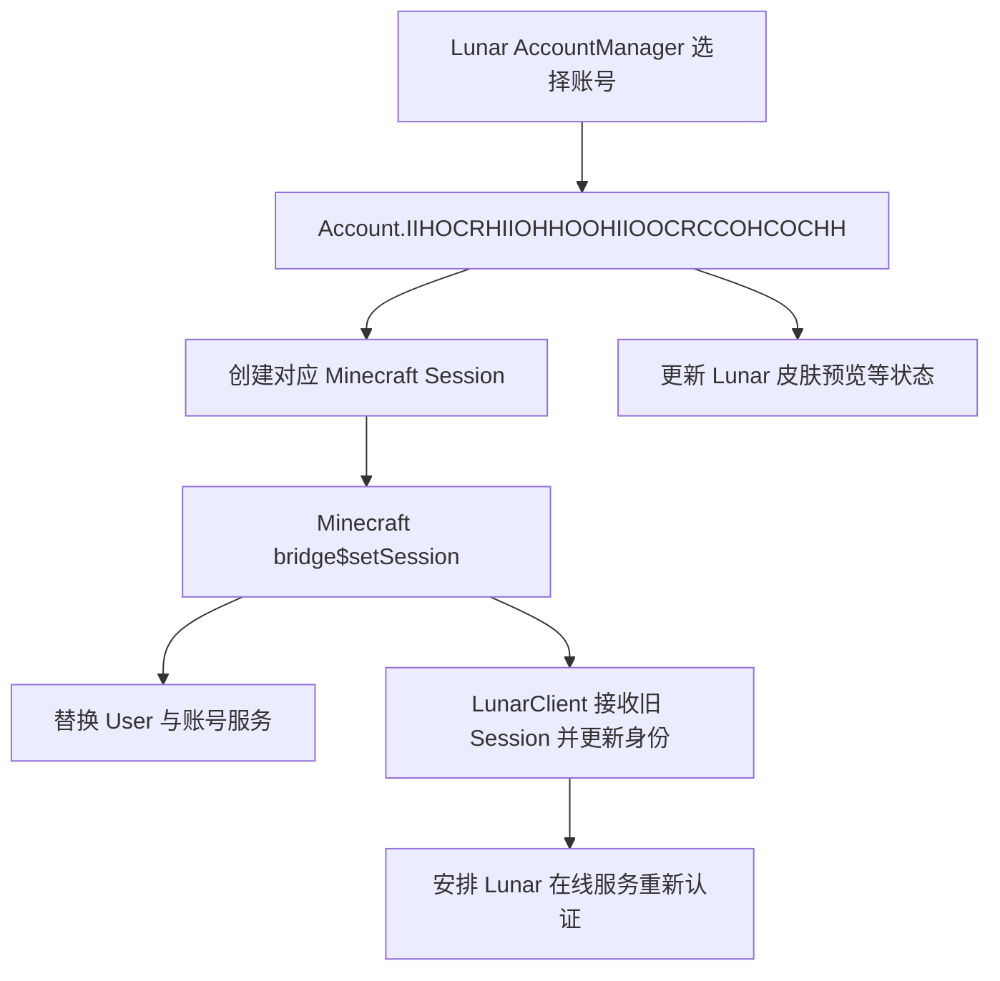
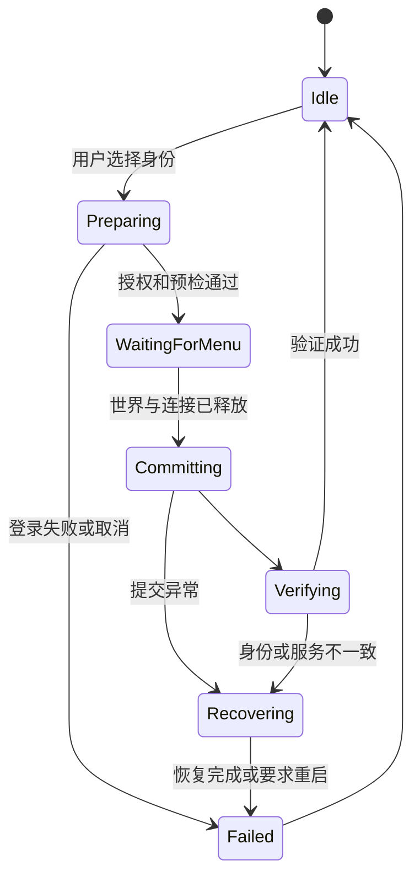

# Nova Account Manager：Lunar / Minecraft 账号切换设计

状态：分析与设计，尚未实现。分析日期：2026-09-29。用户确认同时支持微软正版账号和离线身份；页面布局按随后提供的 SVG 草稿更新为独立大分类，并增加 Token 登录入口。

## 1. 结论与功能范围

可以在 Nova 中设计账号管理页面，让运行中的 Minecraft 在退出世界后切换账号，无需每次重启游戏。Lunar 已有完整度较高的会话切换入口，应优先复用其账号管理流程，而不是仅改 Minecraft 的名字、UUID 或 access token。

需要分清三层身份：

| 层级 | 作用 | 本功能的处理方式 |
| --- | --- | --- |
| Lunar Launcher 账号库 | 保存账号、启动时选择身份、参与令牌刷新 | 使用已有账号时调用 Lunar 流程；不直接改写其账号文件 |
| Minecraft 会话 | 进服务器认证、玩家 UUID、签名聊天、权限、皮肤 | 本功能的核心切换对象；必须完整更新相关服务 |
| Lunar 在线服务 | Lunar 身份、资源/外观服务及相关连接 | 正版账号走正常认证；离线身份显示为未登录，不冒用之前账号 |

“游戏里切换成功”不等于 Launcher 窗口的选择立即同步。是否影响下次启动、Launcher 是否实时刷新，需单独验证；首版不承诺控制整个 Launcher。

提供 Lunar 已登录账号、Nova 微软授权账号、离线身份三种来源，并支持用户提供自己的 Minecraft access token 作为临时正版登录方式。Token 登录不等于微软授权，不具有自动刷新能力。

## 2. 分析样本与证据

本次使用 Recaf MCP 对本机 Lunar 1.21.11 缓存进行静态反编译与调用引用分析：

- `C:/Users/13366/.lunarclient/offline/multiver/cache/d1937f9/2b715c4b/bake.zip`
- SHA-256：`7CAD03EB3955BC18D97C95FA1A0CD898D4BCD62AD5233A3344DFAD38CE5971F3`
- Recaf 主资源包含 17,856 个类；分析结束时没有修改的类。
- 该 ZIP 使用点分隔类名作为条目名，不是常见的 `path/Class.class`。
- 未读取实际账号文件的内容、进程启动参数或令牌值；下述字段来自程序静态代码。

下面为便于阅读使用别名；这些别名不是 Lunar 的真实源码类名。

| 别名 | 本次样本中的完整类名 |
| --- | --- |
| Minecraft | `net.minecraft.class_310` |
| User | `net.minecraft.class_320` |
| AccountManager | `com.moonsworth.lunar.client.OIOIICIHIOORICIIHRRIHIHOOCOOOO.HCHORCCCCHCOHHHROOCIRICCCIRHHH.RCRHRICCICICHOOCCCIRRCIRCICIOC` |
| Account | `com.moonsworth.lunar.client.OIOIICIHIOORICIIHRRIHIHOOCOOOO.RCRHRICCICICHOOCCCIRRCIRCICIOC.RCRHRICCICICHOOCCCIRRCIRCICIOC` |
| XboxAccount | `com.moonsworth.lunar.client.OIOIICIHIOORICIIHRRIHIHOOCOOOO.RCRHRICCICICHOOCCCIRRCIRCICIOC.HIOORCHCOIHRCHRRIIOIICCOHCHOCO` |
| MinecraftBridgeMixin | `com.moonsworth.lunar.HCHORCCCCHCOHHHROOCIRICCCIRHHH.HIOORCHCOIHRCHRRIIOIICCOHCHOCO.CROOIHHIORIOCIHCRRCHOIOCOHRCHO.OOHRHCHRCRRIORCIIICRCICCRRRCHR` |
| SessionBridge | `com.moonsworth.lunar.CROOIHHIORIOCIHCRRCHOIOCOHRCHO.OIRIIHIORRRICHCIORHHCRHCHOICRH.OHORROCRIHOOIROOOHOOHICCHRIRHO` |
| LunarClient | `com.moonsworth.lunar.client.RCRHRICCICICHOOCCCIRRCIRCICIOC` |

混淆名随 Lunar 更新可能变化。上述证据属于磁盘缓存；不能据此假设所有桥接方法已在当前 JVM 完成变换，实施前还需只读验证实际类、方法描述符和对象接口。

### 2.1 Minecraft 启动后的身份链

`Minecraft.<init>(class_542)` 从启动配置取得 User，写入 `field_1726`。User 的实际构造器为：

```text
(String, UUID, String, Optional<String>, Optional<String>)
```

`field_1982` 是名字、`field_1985` 是 UUID、`field_1983` 是 access token。两个 Optional 的具体用途应继续按版本校验，不能沿用旧版构造签名；此构造器没有旧版本的账号类型枚举参数。空参构造器是 Lunar stub，会抛异常，不能调用。

登录服务器时，`net.minecraft.class_635.method_2892(String)` 使用当前 User 的 UUID 和 token 调用 `MinecraftSessionService.joinServer(...)`。所以仅修改 UI 名字不能切换服务器认证身份，也不能用离线身份进入开启正版验证的服务器。

启动时还会建立以下依赖：

| 字段 | 含义/可观察作用 |
| --- | --- |
| `field_45899` | 异步取得的 GameProfile；`method_53462()` 会使用它 |
| `field_26902` | 持有账号令牌的 UserApiService |
| `field_47680` | UserProperties future，参与聊天、多人、Realms 等权限判定 |
| `field_39068` | ProfileKeyPairManager，关联账号 UUID 和聊天签名密钥 |
| `field_26842` | PlayerSocialManager，持有自己的 UserApiService |
| `field_41331` | 账号关联的遥测管理器 |
| `field_39492` | 举报上下文及发送器 |
| `field_39718` | Realms 数据获取器 |
| `field_17763` | 启动时以 User 构造的 `class_4008`，实施时继续核对其缓存 |
| `field_62106` | Services；`comp_837()` 提供 MinecraftSessionService |

不要把所有共享服务都无差别重建：Services/皮肤缓存是否需要替换取决于环境和账号依赖；应按引用关系检查，避免重复注册资源监听器。

### 2.2 Lunar 已有切换流程

静态调用链已经确认：



AccountManager 的 `RCRHRICCICICHOOCCCIRRCIRCICIOC(Account, boolean)` 先更新当前账号，再调用 Account 的上述方法；boolean 分支还会调用持久化相关入口，具体副作用需要实施前验证，不能随意传 true。

`bridge$setSession(SessionBridge)` 已确认执行：

1. 保存旧 User，替换当前 User。
2. 创建新 GameProfile future，并通知 LunarClient 身份变化。
3. 建立新 UserApiService、ProfileKeyPairManager。
4. 更新 Realms 数据获取器、PlayerSocialManager、举报发送器。
5. 关闭旧遥测管理器，再创建新管理器。

该方法不是事务：早期已经替换 User，后续步骤仍可能失败。不能把“调用没有返回错误”直接当成完成。

在本次反编译的桥接类中没有发现 `field_47680` / `fetchProperties` 的更新；这意味着切换后权限缓存是需要专项核查的风险点，不代表已经通过实测确认 Lunar 存在故障。Nova 必须检查并刷新新账号权限，不能沿用旧账号允许多人/聊天的状态。

### 2.3 Lunar 还会主动刷新与重载账号

AccountManager 的事件处理会检查当前账号有效期：先重载账号状态，看 Launcher 是否已经刷新；否则走账号自己的刷新流程。XboxAccount 的有效性判断使用 `Instant.now().isBefore(expiresAt)`。

AccountManager 静态代码引用 `accounts.json`，另有 `launcher_accounts.json` 回退路径；加载时识别 `activeAccountLocalId` 和账号列表。这是结构分析，未读取这些文件里的实际凭据。

LunarClient 在线认证同时使用当前 Minecraft Session 和 AccountManager 的当前 Account。因此直接替换 Session、却保留旧 Account，会出现两套身份不一致。离线切换后，也必须避免旧账号刷新回调重新覆盖会话。

## 3. UI 设计

### 3.1 大分类与草稿解释

账号管理新增 **ACCOUNTS** 大分类，与 **MODULES / CLIENT / BROWSER** 同级；分类下放 **Account Manager** 入口，结构与 `BROWSER → Chrome` 一致。页面不再放到 Client → Settings 内，也不作为模块开关进入 ArrayList。

用户 SVG 来源：`C:/Users/13366/.codex/attachments/2065464f-3155-416a-83ed-32bcbd59f250/已粘贴的文本.txt`。草稿只约定布局关系；1452×793、矩形尺寸、灰白填充、文字大小和圆角都不是实现数值。SVG 后绘制的背景盖住了前面的部分账号行和底部按钮，核对时已检查遮挡下的内容；实现保留这些元素。

```text
现有左侧导航                  账号页内容区
MODULES                       账号管理                   当前身份 / 刷新
  Combat / ...                ┌────────────────────────────────────┐
CLIENT                        │ 头像  名字  类型/状态    切换   删除 │
  Settings                    │ 头像  名字  类型/状态    切换   删除 │
BROWSER                       │ 头像  名字  类型/状态    切换   删除 │
  Chrome                      │                 列表可纵向滚动     │
ACCOUNTS                      └────────────────────────────────────┘
  Account Manager             添加微软账号   添加离线账号   Token 登录
现有左下角入口
```

现有客户端 Logo、左下角入口和主窗口外观沿用 ClickGUI；新页只增加导航分组和右侧内容。ACCOUNTS 排在 BROWSER 下方，侧栏高度不足时导航区域可滚动，不能覆盖左下角入口。不要继续累计固定 y 坐标直到溢出。

### 3.2 账号列表与底部操作区

- 主体使用占满可用宽度的单列账号行，保持草稿的上下排列，不拆成左右两列。
- 每行左侧显示头像，中间显示名字、类型/来源和状态，右侧保留切换操作和始终可见的删除图标按钮。长名字省略显示、悬停可见完整名字，不能挤走删除按钮。
- “当前账号”标记来自真实 Minecraft Session；鼠标选中的行与当前使用的账号分别表示，单击选择不会立即切换。点击切换执行原设计的会话事务。
- 已在世界中时，切换操作显示“返回主菜单并切换”；明确点击后才断开世界，不自动重连。
- 删除按钮独立命中，不触发行选择或切换。删除从 Nova 管理的列表/存储移除，不删除微软账号、Launcher 账号或当前服务器身份；删除当前使用账号的记录不会立即使游戏退出。当前会话作为临时条目保留到切换或退出。
- Lunar 来源条目删除后记入 Nova 的隐藏列表，普通刷新不会立刻重新显示；通过页面更多菜单的“显示已隐藏的 Lunar 账号”恢复。
- 账号列表独立滚动；底部三个按钮固定在内容区底部，从左到右为“添加微软账号”“添加离线账号”“Token 登录”。这些操作不放在顶部。
- 正常宽度三个按钮同一行、等宽、等间距。受支持的 GUI 最小尺寸须保证标签可见；极窄视口允许底部按钮换行，并相应减少列表高度，禁止水平裁切。
- 顶部仅保留标题、简洁当前身份/状态、刷新及更多菜单；“恢复启动账号”放在更多菜单，保留草稿简洁的主体结构。
- 空列表、无搜索结果、登录中、切换中、登录失败都有明确状态。异步更新保留当前选择和滚动位置，行使用稳定账号 ID，不随状态变化重新排序。

### 3.3 统一控件与动画

所有样式复用当前 ClickGUI，不把 SVG 路径文字或草稿图片作为页面背景：

| 元素 | 实现要求 |
| --- | --- |
| 导航与选中反馈 | 与现有 Browser/模块导航共享绘制和 Motion；账号图标来自已有字体图标体系 |
| 文字与头像 | 使用现有 Fonts、PushText 和字号层级；文字在行内垂直居中，头像不改变行高 |
| 账号行 | 使用 ColorTheme 的面板、分隔线、文字及高亮颜色，圆角和内边距与现有卡片一致 |
| 底部/行尾按钮 | 复用现有按钮背景、悬停、禁用和点击反馈；没有额外的缩放弹跳或强发光 |
| 输入框 | 使用现有输入框的柔和填充、边框、文本选择高亮、焦点及动画；不另做高亮白边 |
| 弹窗 | 复用 BeginPanelPopup / EndPanelPopup、PopupBackdrop、PopupMotion；背景透明度、Blur 和层级与其他子 UI 一致 |
| Light / Dark | 读取当前 PanelThemeColors，禁止写死纯黑、纯白或草稿灰色 |
| 全局尺寸 | 布局逻辑坐标通过 Scale 缩放一次；行高依据字体/控件高度，宽度依据实际剩余内容区 |
| 列表更新 | 新增/删除仅做短距离展开收起及透明度过渡，遵循现有 Motion 节奏；其他行不循环漂移 |

不新增装饰性进度条、宽厚滚动条或新的一套控件。列表仍支持滚轮，焦点项需要时滚入可见区域；新增/删除动画必须同步交互区域和裁剪，不能出现透明但仍可点击的旧行。

右侧内容从同一个布局矩形计算标题区、列表区和底部操作区。底部高度 = 实际按钮行高 + 上下内边距；列表高度 = 内容剩余高度。布局不能按 SVG 原始坐标做等比例贴图，也不能固定三条账号后留一大片不可用空白。

### 3.4 三个添加弹窗

- **添加微软账号**：显示授权说明与“开始登录”，使用官方授权流程；完成后显示真实 profile，允许用户选择切换。网络请求不能阻塞 GUI。
- **添加离线账号**：仅输入名字，使用原设计的规则即时校验；确认后加入列表，不未经用户操作就退出当前世界。
- **Token 登录**：单个默认掩码输入框、显示/隐藏按钮、“验证并添加”和取消；无密码框、自动剪贴板读取或令牌获取工具。只有用户显式粘贴才读取输入。
- 弹窗打开位置、焦点、拖动能力和边界约束遵循现有子 UI；不会被浏览器或全屏界面盖住。关闭弹窗取消尚未提交的任务，并清理临时敏感输入。

主菜单没有 player/world 时也必须能打开页面和执行任务，不能放进依赖 PlayerTick 的模块逻辑。

## 4. 账号来源与登录方式

### A. Lunar 已登录账号

从已有 AccountManager 对象读取名字、UUID、来源和有效期状态，给 UI 返回不含凭据的快照。使用已有 Account 引用调用正常切换/重新授权路径；不把 Lunar token 复制到 Nova 文件。

目标是与 Lunar 当前账号状态同步。需要验证上层账号选择入口、游戏线程提交点、刷新中状态和持久化副作用。不能只调用 Account 对象的低层 apply 方法，否则管理器可能仍指向旧账号。

### B. Nova 微软授权账号

由用户在微软官方页面登录，Nova 不提供密码输入框。首选系统浏览器的授权码 + PKCE；设备码授权可作为受支持的备用路线。

认证链设计：Microsoft OAuth → Xbox Live → XSTS → Minecraft access token → Minecraft profile / entitlement 校验。账号是否可访问多人、聊天、Realms，继续使用该账号的真实权限结果。

实施前必须准备属于 Nova 的合法 public-client 应用注册，确认 redirect URI、scope 和 Minecraft/Xbox 服务的应用接入要求；不能直接复制 Lunar 或其他启动器的 client ID。当前文档没有验证这项外部接入条件，不承诺填一个 ID 即可上线。

OAuth 工作线程处理网络请求，校验 state、PKCE、回调来源和授权结果；只监听 loopback，支持取消、超时和刷新令牌轮换。禁止把 token 放在日志、命令行或 UI 数据模型。

Nova 授权身份先保证 Minecraft 会话完整切换；Lunar 在线服务只有在适配器能通过其正常认证流程完成同步后才显示“已登录”。如果需要 Lunar 自身登记，提供“在 Lunar 中授权”入口，不伪造 Lunar 已认证状态。新 token 不能与旧 Lunar Account 混用。

### C. 离线身份

名字建议限制为兼容服务器的 `[A-Za-z0-9_]{3,16}`，按原版离线规则由 `OfflinePlayer:<name>` 生成 UUID。名字改变，离线 UUID 也改变；不要随机 UUID。

只用于单人和允许离线身份的服务器。该身份没有微软凭据、正版皮肤保证或签名聊天密钥，Lunar 在线服务显示未登录。

不能直接把在线 User 的 token 清空就结束：需使用离线 UserApiService、空 profile-key manager 和离线权限数据，移除对旧账号的引用。当前 Lunar 桥接仍参考启动时的 `field_61503` 离线标志，且会触发 Lunar 认证通知；因此离线路径必须单独适配，不能盲用在线桥接。也不能只翻转该启动标志而不审计其他使用点。

### D. Token 临时登录

按 SVG 新增此入口。首版明确只接受用户自己账号的 **Minecraft access token**，不混淆为 Microsoft access token、refresh token、Lunar JWT 或旧式 session 字符串。弹窗直接说明所需类型。

通过官方 Minecraft profile 等适用接口校验 token，账号名字与 UUID 来自服务端返回，不允许用户填写另一套身份配对。验证结果需区分无效/过期、网络暂时失败和不具备访问资格；验证失败不得提交会话。token 只发给固定的官方 Minecraft 服务域名，不允许用户自定义校验地址或携带认证头跨域重定向。

该条目标记为 `Token · 临时`；凭据仅保存在当前会话内存中，不进普通配置、明文账号文件、日志或错误正文。没有 refresh token 就不承诺自动续期；到期后提示重新授权/提供有效 token。删除记录或卸载时清理 Nova 持有的副本，游戏当前会话所需的数据仍遵循会话收尾规则，不强行清空正在使用的 User。

切换依然使用同一个 SessionAdapter 和退出世界事务，不创建绕过流程。Minecraft 登录成功与 Lunar 在线服务成功分别展示；缺少合法 Lunar 账号关联时不伪装成已登录 Lunar 服务。

## 5. 代码结构与线程边界

以下均为拟新增原生 C++ 文件，不生成 Java 源码、辅助类或新的 Java 字节码：

```text
Client/src/
  contracts/AccountService.h              # 元数据快照、状态、命令，不含 JNI/token
  ui/clickgui/accounts/AccountPage.*      # ImGui 列表、操作、状态反馈
  minecraft/accounts/
    AccountManager.*                     # 状态机、唯一切换任务、会话代次
    AccountStore.*                       # 独立于模块配置的凭据存储
    MicrosoftAuth.*                      # C++ HTTP/OAuth/Xbox/Minecraft 授权
    TokenAuth.*                          # 用户提供的 Minecraft token 验证与临时身份
    OfflineIdentity.*                    # 名字校验及离线 UUID
    SessionAdapter.*                     # 版本能力与统一操作接口
    lunar/LunarAccountAdapter.*          # Lunar 管理器与会话桥接
    vanilla/VanillaSessionAdapter.*      # 非 Lunar 的版本实现
```

公共 UI 只依赖 contracts，不能 include Minecraft/JNI。MinecraftHost 注册服务；CS2 不提供此能力。Lunar 类/成员映射归现有 `compat/mappings` 对应版本，不散落在 UI 或账号业务里。

UI 线程仅发送命令与读取快照；HTTP 在工作线程进行；JNI 会话提交使用主菜单也运行的 GameTick 队列。现有 `HookGameTick` / `GameTickEvent` 可作为接入点，但仍需验证每个 profile 主菜单事件的实际触发。不创建 Java Runnable 实现来跨线程调度。

接口建议：`ListAccounts`、`BeginMicrosoftLogin`、`ValidateTokenLogin`、`AddOffline`、`RemoveAccount`、`RequestSwitch`、`RestoreLaunchAccount`、`Cancel`、`Status`；内部适配器提供 `Probe`、`Prepare`、`Commit`、`Verify`、`Recover`。敏感输入通过独立命令移交认证服务，不进入长期 UI 快照。

`PageLayout` 增加独立 `AccountsPage` 路由并在导航里注册 ACCOUNTS 分组；是否显示由宿主账号管理能力决定。不能通过伪造 module category 把账号页塞进普通模块列表。导航剩余高度、独立页面搜索行为和弹窗生命周期统一处理；全局模块搜索不得把账号列表替换成模块列表。现有左下角 `PageLayout::account()` 是 Windows 用户名/客户端设置入口，不等于游戏账号管理，不能把它的 `USERNAME` 当作 Minecraft 名字。

## 6. 切换事务与竞争处理



1. 预检版本能力、目标账号状态和切换冲突。记录启动身份与当前完整会话快照，JNI 引用有明确生命周期。
2. 正版账号在后台验证授权/profile；失败时不改变现有身份。预先准备可独立构建的新对象和已完成 future，避免主线程进行长时间 HTTP 等待。
3. 正在游戏时等待用户明确选择退出，并等待 world、连接、连接中的异步任务、单人服务器保存/关闭全部完成。切换期间阻止新的连接任务。
4. 暂停会话相关自动操作，清理旧世界目标、背包会话和包缓存，释放按键与 rotation ownership；不修改用户保存的模块开关配置。
5. 在游戏线程使用适配器提交。Lunar 已有账号走上层账号选择流程；Nova/Offline 身份走经过验证的会话与 Lunar 状态协调路径。
6. 核对 Minecraft User、GameProfile、AccountManager 当前身份、签名管理器、权限数据和 UI 的一致性。Lunar 在线连接的成功与失败单独报告，不能用本地有效 UUID 冒充认证成功。
7. 更新 Nova HUD 的自身名字/头像缓存，解除切换锁，等待用户手动进入世界。

所有 Nova 异步任务携带递增 generation；旧任务完成后不能提交到新身份。Lunar 自己的刷新回调不受这个计数自动保护，必须验证并接管其账号所有权协调：在其登录/刷新忙碌时延后切换，处理账号重载和正在途中的认证回调。无法证明旧任务已经隔离的版本，应禁用对应切换路径，不使用每 tick 强行写回 Session 的办法。

回滚不能简单恢复几个 jobject：Lunar 桥接会关闭旧遥测对象，且已触发外部连接。应对旧身份执行恢复流程并重建已关闭的依赖，再验证；恢复失败则留在主菜单、阻止连接并提示重启，不能继续以混合身份进入服务器。

退出 Nova/熔断时停止新请求、取消后台任务并完成安全收尾，不能让已卸载 DLL 的回调继续执行。已成功切换的账号不因熔断而在服务器中被强制换回。再次注入时读取真实当前会话，不能自动覆盖为上次保存的账号。

## 7. 存储

账号数据独立于默认配置和各模块配置，避免“熔断保存全部配置”时复制凭据。

- 元数据：账号来源、显示名、UUID、内部 ID、最后使用时间；不保存密码。
- Nova 微软 refresh token 使用 Windows DPAPI 当前用户加密，限制文件 ACL，原子更新；access token 尽量只保留内存。
- Lunar 来源只存引用标识，不导出其凭据；离线身份只需名字和 UUID。
- DPAPI 文件不能直接复制到另一台电脑使用；换机器重新授权。
- 默认不把 Nova 新增账号写入 Lunar 文件；Launcher 同步作为后续独立能力，不直接编辑 `accounts.json`。
- 日志只记阶段和脱敏错误分类；不输出 User/Account 的完整 `toString()`、OAuth 响应或认证 HTTP 头。

## 8. 支持范围与实施顺序

| Profile | 本轮验证程度 | 实施要求 |
| --- | --- | --- |
| Lunar 1.21.11 | 已反编译启动、账号管理、会话桥接和服务器认证链 | 首批适配；运行时探测、事务和离线协调需实测 |
| Lunar 1.8.9 / 1.7.10 | 本轮未逐版验证 | 独立核对 Session 构造、桥接、账号管理器和认证服务 |
| Forge 1.20.1 | 本轮未验证账号切换 | 原版适配器，不能依赖 Lunar 类 |
| Minecraft 26.3 | 本轮未验证账号切换 | 单独处理 authlib/服务结构变化 |
| EaseCation 等其他 profile | 本轮未验证 | 能力探测未通过时只展示当前身份 |

建议分四步交付：

1. 只读诊断与 Accounts 页面：显示真实当前身份，检测主菜单可用性及当前 Lunar 运行时映射。
2. Lunar 已授权账号切换：复用其已有流程，完成 A→B→A、过期/失败和熔断测试。
3. 离线身份与恢复：完成 Lunar 认证隔离、主菜单事务、离线权限及恢复正版的测试。
4. Nova 独立微软授权、Token 临时登录与其他 profile：在应用接入条件满足后实现 OAuth、加密存储，补充官方 token 验证，再逐版本验证。

不把 1.21.11 的静态分析结论标成“全版本已支持”。Lunar 更新后，按类结构、描述符及实际能力探测重新核验；缺少必要能力时明确显示不可切换。

## 9. 验收标准

- 两个本人已授权正版账号在主菜单反复 A→B→A：名字、UUID、服务器登录、皮肤、签名聊天及权限均使用选中账号。
- 正版→离线→正版：单人/离线服务器能使用离线身份，正版服务器不会误报已认证；恢复后无旧 profile-key 串号。
- 连续点击、取消授权、网络超时、授权撤销、账号无 Java 版访问资格：保留原身份，不自动绕过错误。
- Lunar 刷新中/Launcher 更新账号文件/Nova 授权完成同时发生：不会切回旧号、提交过期任务或混用账号。
- 打开世界、正在连接、断线未完成、单人保存中：不在半途中替换会话。
- 每个提交步骤注入失败：能恢复旧身份，或稳定停在主菜单并要求重启；不继续带病连接。
- 默认配置保存、导出配置、熔断、重新注入：无凭据进入普通配置或日志，无悬挂线程和 JNI 引用。
- 主菜单、世界内、Light/Dark、不同 GUI 尺寸：页面风格一致，功能按钮与实际能力一致。
- ACCOUNTS 与 MODULES/CLIENT/BROWSER 同级；底部三个入口固定可见；0、1、3、大量账号与长名字均不挤压行尾删除按钮。
- 新增分类不覆盖左下角入口；切换页面不会残留输入焦点或弹窗；缩放、窗口边界、浏览器全屏下弹窗的 Blur 与层级正常。
- Token 验证成功、无效、过期和取消：身份来自官方返回，敏感值不落盘、不出现在普通配置和日志中；离开页面后没有过期回调误添加账号。

以上是设计与验收目标；当前实施范围、已验证项目和运行限制见下一节，不代表所有验收场景已经实测。

## 10. 首版实施（2026-09-29）

已实现原生 C++/JNI 版本，没有新增 Java 源码、Java helper 或 Java 类。入口为 Panel ClickGUI → ACCOUNTS → Account Manager，和 MODULES / CLIENT / BROWSER 同级；主区域采用单列账号卡片、右侧移除按钮和底部三个固定入口。搜索、字体、颜色、输入框、悬停、弹窗动画和弹窗背景复用现有 Panel 系统。

### 登录路径

- **Add Microsoft**：原生 C++ 直接打开系统默认浏览器，无需填写 Client ID。默认采用 IAS 9.0.8 的公开应用 ID、scope、完整注册回调路径和候选端口；只监听回环地址并验证 state。保留已有自定义应用的 8247 回调和 PKCE。回调返回 Minecraft 进程，随后调用 Xbox Live、XSTS 和 Minecraft 官方接口，再提交现有 SessionAdapter。没有复制应用密钥。[登录说明](microsoft-browser-login.md)。
- **Lunar 原生账号页**：重定向添加账号的 Launcher IPC 调用、选中账号的查询入口和 XboxAccount 的刷新 IPC 调用，统一提交 Nova 请求。选中入口在原版空 token 分支之前接管，因此缺少凭据的账号也能重新授权。旧 Launcher 回调不再执行，避免重新载入启动器文件覆盖新身份。
- **单人/多人入口**：Lunar setScreen 对这两个目的地识别已提交且 UUID/名字匹配当前 User 的 Nova 会话，避免离线身份因 Launcher 未选中账号而再次触发登录。此例外只用于菜单导航，其他界面、Lunar 在线认证和服务器认证不受影响。
- **Lunar 现有账号**：有效凭据通过 Minecraft 官方 profile 验证和 authlib 权限查询后切换；标记失效的账号进入浏览器重新授权。同 UUID 的 Nova 微软账号优先使用自身刷新凭据，失败为 invalid_grant 时转浏览器，不回退启动器。
- **Add Offline**：3–16 位英文字母、数字或下划线；UUID 使用原版 `UUID.nameUUIDFromBytes("OfflinePlayer:" + name)`，使用 OFFLINE UserApi、离线权限和密钥管理器。只适用于离线允许的场景，不提供正版服务器认证。
- **Token Login**：输入 Minecraft access token（不是 Microsoft refresh token），通过固定 HTTPS 主机 `api.minecraftservices.com/minecraft/profile` 验证。禁止携带认证头重定向；限制输入/响应体长度与网络超时。显示名和 UUID 使用服务端返回值，凭据不写入磁盘。

### 切换与生命周期

- ImGui 仅提交命令和读取不含凭据的快照。游戏线程定期处理请求，网络验证在单独的原生工作线程执行。
- 仅在无 world/player/连接/单人服务器的断开状态提交；支持 Lunar 自定义主菜单，不再要求界面继承原版 TitleScreen。连接、加载及进度界面仍阻止提交；验证结束时再次检查，避免连接中的会话被替换。
- 同时只接受一个验证任务。提交时重新检查 Lunar 的登录/刷新状态、原会话 UUID **和原 User 对象引用**，避免旧任务覆盖后来建立的新会话。
- 在改动当前 User 前准备 profile、权限 future、UserApi、聊天签名、社交、举报、Realms 和遥测对象。同步提交出错时恢复原字段；旧遥测只在提交成功后关闭。
- 同步更新标题 SplashManager 持有的 User 和 RealmsClient 静态缓存，避免沿用前一个账号。自定义身份清空 Lunar 的当前账号选择及 Sentry 身份，随后通知 Lunar 自身处理身份变化和资产连接。
- 微软授权期间应保持在主菜单；若期间进入世界，完成时的断开状态和原会话检查会拒绝提交。回环 HTTP 监听、工作线程和取消由 Nova 管理；回调验证随机 state 和路径，自定义应用额外使用 PKCE，限制请求大小和时间。已在世界内的 Lunar 后台刷新不会弹出浏览器或提交换号。
- 熔断停止新请求并清空队列，等待工作线程结束后释放 JNI global refs 和临时 token。网络线程若无法在收尾窗口结束，则沿用项目的保留 DLL 策略，避免卸载后执行悬空代码。

### 存储和删除

`%LOCALAPPDATA%/Nova/Accounts/metadata.json` 保存离线账号、隐藏 Lunar ID、公开 Client ID，以及 Windows 当前用户 DPAPI 加密的 Nova 微软刷新凭据，使用临时文件和原子替换。Token 账号和 access token 仅在本次注入的内存中保存；普通配置、默认配置和熔断保存不含 token。不写入 Launcher 账号文件，新授权账号由 Nova 独立管理。

移除 Lunar 卡片只隐藏 Nova 中的条目，不调用 Launcher 删除账号；按用户要求，页头 Microsoft 和 Restore 按钮均不再显示。移除当前条目不替换正在使用的游戏身份。页面与添加弹窗不显示额外说明小字，只保留账号信息和实际操作状态。

账号行高 42、行距 6，单行昵称和皮肤头像垂直居中，当前账号以勾选标记区分。移除按钮使用居中垃圾桶图标；按钮、账号行和输入框使用 Panel 的字体、色板及 Motion 动画。删除 Microsoft/Lunar 等来源副标题。底部三个入口在断开状态可用；世界内可以打开添加弹窗，但实际切换仍需退出世界，禁用按钮按主题降低透明度。

头像按 UUID 使用 Lunar 自身的 `skins.mcstats.com/face/UUID` 服务，原生线程异步加载、WIC 解码，缓存至共享 SkinTextures。请求不附带账号凭据，限制超时、大小及重定向，失败后间隔重试。后台线程只保存像素，游戏线程发布纹理句柄，熔断后停止发布并等待线程结束。

### 文件归属

| 位置 | 职责 |
| --- | --- |
| `src/contracts/AccountService.h` | 无 JNI 的快照和命令契约 |
| `src/ui/clickgui/accounts/` | 账号页面、样式和线程安全命令交换 |
| `src/minecraft/accounts/AccountManager.cpp` | 请求调度、持久化、工作线程和熔断收尾 |
| `src/minecraft/accounts/lunar/` | Lunar 1.21.11 映射、JNI 检查、会话准备与提交 |
| `src/minecraft/accounts/TokenAuth.cpp` | 官方 Minecraft token/profile 验证 |
| `src/minecraft/accounts/MicrosoftAuth.cpp` | 浏览器 PKCE、回环回调、Xbox/Minecraft 令牌交换 |
| `src/minecraft/accounts/CredentialStore.cpp` | 当前 Windows 用户 DPAPI 加解密 |
| `src/minecraft/accounts/lunar/AccountHooks.cpp` | Lunar 原生添加、选择和刷新入口接管 |
| `test/accounts/` | 输入、请求并发和停机边界测试 |

### 已完成验证与范围

首版仅开放 **Lunar 1.21.11** 账号切换，其余 profile 显示不可用原因。通过 Recaf 核对当前 bake JAR 的 55 项核心方法/字段描述符；通过原生输入/队列测试和 Release DLL 静态 TLS 检查。`NovaUiPreview --accounts-smoke` 用模拟账号渲染真实 Accounts 页面，检查深浅主题、弹窗打开和 Esc 关闭；预览不登录任何真实账号。

尚未代替用户执行微软授权、真实账号切换或服务器登录，因此实际 OAuth、A→B→A、签名聊天、皮肤与账号过期流程仍需游戏内验证。这里的编译和静态映射检查不等于在线登录测试。
