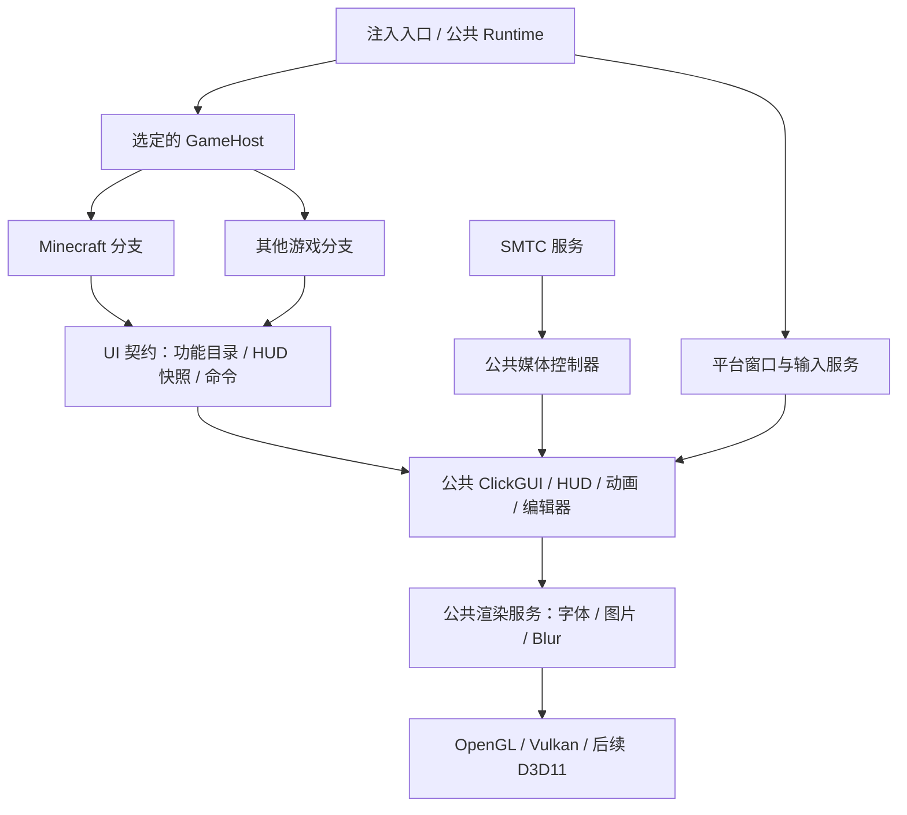

# 多游戏接入与 UI / HUD 独立化设计

状态：实施中，见[实施进度与验证记录](multi-game-ui-progress.md)。本文的现状分析是实施前基线，源码链接随迁移更新；尚不代表已经支持其他游戏。

## 1. 目标与核心决策

将整套 ClickGUI、HUD、通知、主题、字体、动画、编辑拖动和媒体展示从 Minecraft 中独立出来，像现有 SMTC 服务一样成为公共组件。Minecraft 分支负责游戏数据采集、功能逻辑、设置绑定和调用公共 UI；公共 UI 不读取 Minecraft，不依赖 JNI、mapping 或 Minecraft 模块。

最终关系：**游戏提供数据，公共 UI 管理展示，图形后端负责提交绘制。**

所有 HUD 都按这个原则拆分，包括 TargetHUD、AutoBlockHUD、NameTags、ESP、BedPlates、挖床进度等游戏数据相关界面。不能只独立 MusicHUD、把其他 HUD 留在 Minecraft 模块里。

实施约束：

- 保留现有视觉风格、布局、动画、设置及配置兼容性，先拆依赖，再接入其他游戏。
- UI/HUD 只有一份实现，不能为每个游戏复制一套。
- 原生部分继续使用 C/C++，不新增 Java 源码。
- 继续保留单文件注入器发布方式；第一阶段使用同一 DLL 中的静态游戏适配器，不引入外置插件 DLL。
- `src/third_party/` 保持现有位置。
- 按用户后续指令开始实施，实际迁移分阶段进行。

## 2. 当前代码中的实际耦合

| 位置 | 已确认的情况 | 拆分方向 |
| --- | --- | --- |
| 原 Loader 游戏启动逻辑，现位于 [MinecraftHost.cpp](../src/minecraft/host/MinecraftHost.cpp) | 启动先等待 JVM，绑定 JNI/JVMTI，再初始化 Minecraft、事件桥和渲染 | [Loader.cpp](../src/core/Loader.cpp) 已改为宿主分派；继续抽离公共生命周期调度 |
| [Profile.h](../src/minecraft/compat/Profile.h) | Profile 的 mapping、能力定义属于 Minecraft；RenderBackend 表示 GLFW/LWJGL2/SDL | Minecraft 版本配置保留在游戏分支；窗口接入与 GPU API 分开 |
| [OverlayHost.cpp](../src/minecraft/host/render/OverlayHost.cpp)（原 GlHook.cpp） | 同时处理窗口、光标、渲染、Minecraft 点击行为、模块更新及卸载 | 拆为图形后端、窗口输入、Minecraft 帧接入与公共帧调度 |
| [VulkanOverlay.cpp](../src/ui/backend/VulkanOverlay.cpp) | 存在 Minecraft 交换链相关逻辑，安装入口从 26.3 取句柄 | 公共 Vulkan 绘制器 + Minecraft 26.3 表面适配器 |
| [FeatureTree.cpp](../src/ui/clickgui/FeatureTree.cpp) | UI 直接遍历 ModuleManager，使用 Module 构造分类和设置 | 公共功能目录模型 + Minecraft 目录适配器 |
| [Module.cpp](../src/minecraft/modules/Module.cpp) | 快捷键门控直接调用 Minecraft ScreenOpen | 公共快捷键机制读取宿主输入策略 |
| [WorldProjection.h](../src/minecraft/host/render/WorldProjection.h) | 相机结构、视角约定和 bobbing 来自 Minecraft | Minecraft 内完成原有投影；公共绘制接收投影结果 |
| [NameTags.cpp](../src/minecraft/modules/render/nametags/NameTags.cpp) | 数据读取、mapping、过滤与绘制在同一实现 | 游戏数据提供器 + 公共 NameTags 视图 |
| [MusicHUD.cpp](../src/minecraft/modules/render/musichud/MusicHUD.cpp) | 媒体视图继承 Module，同时包含展示、设置、编辑与服务调用 | 公共媒体功能控制器 + 公共 MusicHUD/Lyrics 视图 |
| [SmtcService.h](../src/smtc/SmtcService.h) | 已通过快照/命令接口提供媒体服务 | 保持独立服务，复用现有实现 |
| [Config.cpp](../src/config/Config.cpp) | 配置目录由 Minecraft profile 决定，也含游戏设置迁移 | 公共配置存储 + Minecraft 配置迁移适配器 |
| [JavaProcess.cs](../../injector/ui/JavaProcess.cs)、[cli.c](../../injector/cli.c) | GUI 枚举 java/javaw，CLI 也验证 Java 进程名 | 根据目标游戏配置筛选进程 |

现有 SMTC 文档早期段落有“不包含歌词”的旧描述；当前实现已有 Lyrics/YRC。迁移以当前代码和实际行为为准，保留现有歌词能力。

## 3. 目标分层



允许的依赖方向：游戏分支依赖公共契约，UI 依赖契约与渲染服务，渲染服务依赖图形 API。公共 UI、HUD、SMTC 不反向 include 游戏实现。

Minecraft 模块依然可以选择目标、计算格挡率、统计 TPS、筛选实体，但只把结果交给公共组件。UI 不调用 KillAura、AutoBlock、Teams，也不自行查询世界。

“独立”通过两个条件验证：公共组件能在没有 JVM 的原生预览程序中链接运行；公共组件的头文件和链接依赖均不包含 Minecraft 实现。

## 4. 目录和构建归属

以下采用 2026-09-22 确认的平级结构；Minecraft 已归并，CS2 目录预留，后续能力以实施进度为准：

```text
Client/src/
  core/                       公共启动、日志、生命周期、线程与故障状态
  contracts/                  GameHost、UiCatalog、HudSnapshot、UiCommand
  ui/
    backend/                  Win32 窗口、OpenGL/Vulkan、Blur；后续新增 DX11
    clickgui/                 现有两种 GUI、Panel、控件、搜索、子窗口
    hud/
      arraylist/ watermark/ targethud/ autoblockhud/
      nametags/ esp2d/ chestesp/ itemesp/ bedplates/ compass/
      breaker/ musichud/ lyrics/
    overlay/                  HUD 容器、布局、拖动、编辑标题
    notifications/ text/      通知、文字与图标
  smtc/                       现有媒体服务与播放器适配，保持独立
  config/                     公共配置存储；settings/ 为属性定义
  bind/                       公共绑定、按键捕获
  utils/                      游戏无关的颜色、JSON、键盘工具
  minecraft/
    host/                     生命周期、数据采集、UI/配置绑定和帧接入
    compat/                   Minecraft 版本与单文件 mapping
    java/                     C++ JNI 实现；api/ 为 Minecraft 原生接口
    hooks/ events/            Minecraft Hook 与事件
    modules/                  游戏功能及薄的 UI 注册包装
    utils/                    旋转、背包等 Minecraft 工具
  cs2/
    host/ modules/            CS2 宿主和功能，尚未实现
  third_party/                当前第三方依赖
```

每个组件的设置、动画、布局和绘制集中在自身目录。共享契约只放跨边界的数据与接口，不把所有 HUD 私有类型堆在一个大头文件中。

建议构建目标为 `NovaCore`、`NovaUI`、`NovaRender`、`NovaMedia`、`NovaMinecraft`，以静态库或对象库链接为现有 `NovaClientBase.dll`。公共目标不继承 JNI include 路径或 Minecraft 编译定义。

增加只链接公共目标的 `NovaUiPreview` 原生测试程序。它使用示例数据展示所有 HUD，包括游戏专用名称的 HUD，证明绘制已完整独立。

拆分 `src/minecraft/java/api/base.h` 中公共日志/生命周期与 JVM 声明；不能让公共头间接重新引入 JNI。文件移动同步修改显式 CMake 清单、include、测试与结构检查器，不手改生成的工程文件。

## 5. 所有 UI / HUD 的数据边界

| 组件 | 游戏分支提供 | 公共层负责 |
| --- | --- | --- |
| ClickGUI / Panel / 设置子窗口 | 分类、功能稳定 ID、设置模型、可用状态、命令接收器 | 全部控件、搜索、齿轮、拖动、主题、动画与布局 |
| ArrayList | 已启用功能名称、后缀、隐藏标记和稳定 ID | 排序展示、测量、背景、整体 size、逐项动画 |
| Watermark | 可选的玩家名、服务器、TPS 等信息项 | NOVA/自定义名称、图标、字体、布局；FPS 由帧调度统计 |
| TargetHUD | 目标 ID、名称、生命/最大生命、头像资源、附加状态 | 血条、切目标动画、编辑预览、面部/头像绘制 |
| AutoBlockHUD | 是否工作、格挡统计、比例、头像资源 | 展开/收回、数值变化动画、卡片布局 |
| NameTags | 投影后的锚点、文本片段、生命值、装备图标、显隐结果 | Default/Classic 风格、排版、颜色、阴影、背景 |
| ESP2D / ChestESP / ItemESP / BedPlates | 屏幕线段/边框、标注、图片、数量/距离等显示信息 | 线框、标签、条形图、透明度、字体和 UI 组合 |
| Compass | 方向角和标记信息 | 带状刻度、文字、裁剪与位置 |
| Breaker 进度 HUD | 工作状态、目标标识、进度、图标 | 独立位置、尺寸、布局和进度动画 |
| Notifications | 通知事件、等级、文字、持续时间 | 药丸布局、堆叠、展开/退出动画 |
| MusicHUD / Lyrics | 公共媒体控制器读取 SMTC 快照；游戏仅注册/调用 | 封面、控制条、来源菜单、歌词/YRC 高亮和全部动画 |
| HUD 编辑器 | 当前组件目录与可选预览数据 | 拖动、锚点、缩放、标题条、展开与上下位移动画 |

FullBright、FreeLook 等虽然位于 Render 分类，实际改变游戏行为，仍归游戏分支；它们的设置控件继续由公共 UI 绘制。

重要边界：

- UI 不接收 `jobject`、实体指针、Minecraft Module 指针或读取世界的回调。
- NameTags 的队伍颜色/格式码由 Minecraft 适配器转换为公共富文本片段；字体、字距、阴影由 UI 负责。
- 皮肤下载、玩家身份及 Minecraft UV 规则归适配器；输出图片资源或图层/UV 描述，公共头像组件只组合绘制。
- 相机插值、视角摇晃、第三人称和游戏可见性保留原算法，先在游戏分支输出屏幕坐标，避免迁移时改变投影行为。
- 投影结果标记 frame ID 和 viewport 代次；窗口变化或世界切换时丢弃旧数据。不能把上一帧坐标直接套到新视口。
- 新游戏缺少 TPS、装备或格挡数据时由适配器省略对应数据/组件，不填造假的默认值。公共 HUD 仍可在预览程序中展示。

## 6. 接口、线程和状态所有权

接口以内部 C++ 契约实现，第一阶段不设计动态插件 ABI。示意调用如下，名称尚未落地：

```cpp
// 宿主初始化时：共享目录与游戏目录合并，注册一次。
ui.RegisterCatalog(commonFeatures, minecraftFeatures);

// 游戏允许的数据采集时点：发布拥有自身数据的不可变快照。
minecraftPresentation.PublishSnapshot();

// 游戏帧接入点：匹配本帧视口/相机，公共层执行全部绘制。
auto frame = minecraftPresentation.BuildUiFrame(frameContext);
ui.Render(frameContext, frame);

// UI 交互产生命令；游戏逻辑在原有允许的执行时点处理。
minecraftCommands.Drain();
```

具体契约：

- `UiCatalog`：功能 ID、分类、显示名、设置描述、绑定方式、可用状态。UI 不遍历 ModuleManager。现有 Property 控件和格式化逻辑复用，游戏属性经适配器绑定。
- `HudSnapshot`：组件 ID、数据版本、游戏会话代次、可选内容。长寿命数据拥有字符串/数组，不保存 JNI 局部引用；同步帧视图只能在本帧内使用。
- `UiCommand`：设置修改、切换功能、绑定快捷键、配置操作等。通过稳定 ID 路由，带来源代次，防止销毁模块后调用旧回调。
- `FrameContext`：单调时间、delta、逻辑尺寸、像素尺寸、DPI、视口代次、渲染能力；不包含 JNIEnv。
- `InputPolicy`：宿主窗口焦点、是否允许打开菜单、是否有聊天输入、游戏光标捕获方式。Minecraft 提供语义判断，公共层维护按键状态。

状态所有权固定：

- 公共 UI 持有动画、搜索文本、子窗口状态、拖动状态及布局；游戏分支不重复维护这些状态。
- 游戏分支持有游戏功能开关的实际生效状态、实体/世界及采集缓存。
- 公共设置在 UI 所在线程提交；影响游戏行为的设置通过命令队列在原有执行时点应用，并回传结果。输入时即时显示待提交值，失败后同步实际值。
- 先审计现有 Tick/游戏事件/帧回调归属再移动调用，不能直接把所有模块 tick 改到渲染线程或新工作线程。
- SMTC 继续后台生成不可变快照和处理媒体命令；UI 不等待 WinRT、网络或播放器进程读取。
- GPU 资源只在所属渲染上下文创建、提交和销毁；纹理 handle 带设备代次，防止重建后使用旧资源。
- 世界/目标切换按会话代次清理快照；动画使用稳定实体 ID，不能用对象地址匹配玩家。

## 7. 公共渲染与输入

拆开三个概念：`GameHost` 决定数据和游戏接入；`WindowBinding` 处理 Win32/GLFW/LWJGL2/SDL 窗口语义；`GraphicsApi` 才是 OpenGL/Vulkan/D3D11/D3D12。

迁移顺序以现有 OpenGL、Vulkan 行为不变为优先。新游戏尚未确定；如果首个目标使用 D3D11，再以 D3D11 原生预览程序作为首个新增后端。不能因为已有 ImGui 就宣称已支持所有 DirectX 游戏。

渲染器负责 GPU 状态保存/恢复、字体和封面上传、资源退役、多交换链选择、窗口/设备重建。当前封面已经使用 ImGui 用户纹理生命周期，优先复用这套机制，不为每个 HUD 再造纹理上传代码。

Blur 的区域请求、强度、刷新频率、背景 Alpha 和裁剪归公共 UI；背景采样与模糊 pass 归后端。采样发生在 Nova UI 绘制前，主界面和子窗口使用同一帧背景，避免递归采样自己的 HUD。新后端未实现 Blur 时明确报告能力缺失，不能显示可用却无效果的开关。

保留并验证 F11、resize、最小化、Alt-Tab、DPI 改变和设备丢失的恢复。上下文重建不重置用户布局或重新创建 SMTC 工作线程。

公共输入只在菜单捕获期间消费相应事件，关闭菜单时由宿主适配器恢复原光标模式；失焦/卸载时释放已接受的 hold 状态。聊天框阻止菜单误开的规则由 Minecraft 提供，其他游戏提供自己的文本输入状态。

## 8. 启动、故障与卸载

公共 Runtime 按目标 profile 选择宿主，不再全局等待 `jvm.dll`。仅 MinecraftHost 执行现有 JVM、mapping、桥接和 transformer 流程。

```text
Created -> HostInitializing -> SurfaceWaiting -> UiInitializing -> Ready
                                              任一失败 -> Stopping
Ready -> Stopping -> CallbacksDrained -> ResourcesReleased -> Unloaded
                       无法排空 -> InertRetained（保留惰性映像）
```

Ready 必须满足所选宿主的必要规则安装成功、公共 UI 初始化成功且首帧提交完成。SMTC 没有播放器会话不阻止 Ready；其状态在媒体功能中体现。

卸载顺序：停止新游戏/UI/媒体命令和回调入口 → 请求后台服务停止 → 等待已进入回调与 GPU 工作安全完成 → 在所属渲染线程释放 UI/GPU 资源并恢复输入 → 排空媒体与宿主回调、撤销游戏接入 → 最后卸载映像。

每阶段记录状态、错误和超时；无法证明线程/回调不再执行 DLL 时保留惰性映像，沿用现有卸载保护。保留反射加载器静态 TLS 检查，不引入需要额外初始化假设的 TLS 或退出析构。

## 9. 注入器与配置兼容

注入器显示“游戏 → 版本/运行方式 → 进程”，Minecraft 保留现有选项。新目标 profile 描述 game ID、窗口/渲染接入方式与进程匹配规则；自动识别是候选提示，不能仅凭某个 DLL 已加载就确认兼容。

保留 [ClientProfiles.inc](../../shared/ClientProfiles.inc) 的现有 ID 1–4，不复用旧 ID。初期可继续让 Bootstrap 的 `client` 表示唯一目标 profile，由 DLL 内部解析 game ID；如果必须扩展结构，则同步升级注入器和 DLL 的 ABI，并明确拒绝版本不匹配。不能直接改变 ABI 1 的结构含义后继续兼容。

GUI 和 CLI 一起去除仅 Java 的硬编码过滤，按选定目标检查进程架构与 profile。HeyPixel 专用加载路径继续留在 Minecraft 专用入口，不推广为其他游戏的通用路径。单文件发布仍由现有打包流程嵌入所需资源。

配置采用公共偏好与游戏配置分层：

- 公共：主题、字体、客户端名称、媒体来源和媒体展示偏好。
- 按游戏/显示配置：HUD 锚点、缩放、布局覆盖、菜单绑定，防止不同分辨率/游戏互相覆盖。
- 按游戏/profile：模块参数、启用状态、游戏快捷键。

当前 Minecraft 的 `%USERPROFILE%/.nova/configs/`（Forge）及 profile 子目录继续可读；不在第一步移动用户文件。适配器保留旧模块名、配置键和模式索引；新 schema 使用稳定 ID 和显式迁移表。

读取优先级为默认值 → 公共偏好 → 游戏/profile 覆盖 → 当前配置。没有新配置时才导入旧值；迁移带版本标记，不重复覆盖用户修改。写入采用临时文件原子替换；并行游戏实例保存时按作用域串行合并，避免整份旧快照覆盖其他实例。

## 10. 分阶段实施与验收

| 阶段 | 交付内容 | 完成标准 |
| --- | --- | --- |
| 0. 固定基线 | 记录 HUD/GUI 样例、配置键、快捷键与帧/线程调用关系 | 各现有 Minecraft profile 的构建和相关离线检查通过；视觉基线可比较 |
| 1. 建立边界 | 契约、无 JNI 的公共基础头、目录/命令适配；先不大规模搬文件 | 公共 UI 不再遍历 Minecraft ModuleManager 或调用 ScreenOpen；菜单行为保持 |
| 2. 公共 UI/HUD | 迁移全部展示实现，游戏逻辑变为数据提供器；先 Music/通知/ArrayList，再其余全部 HUD | 所有 HUD 可由原生预览程序用示例数据展示；无漏留的 Minecraft 绘制实现 |
| 3. 渲染和生命周期 | 拆 GlHook，抽离 OpenGL/Vulkan、输入、纹理、Blur；MinecraftHost 接管 JVM | 公共 Runtime 不依赖 JVM；现有 MC 的首帧、窗口重建、卸载路径可验证 |
| 4. 目录配置迁移 | 按职责搬入 minecraft/host，更新 CMake、测试、配置迁移和文档 | 公共目标移除 MC/JNI include 仍可独立编译；旧配置加载语义保持 |
| 5. 首个其他游戏 | 确定实际游戏/架构/API，新增 Host 和必要后端，更新注入器 | 同一 DLL 在选定目标显示同一套 GUI、HUD 编辑器、音乐和歌词；用户验证输入与显示 |
| 6. 回归收尾 | 清理过渡调用、重复路径，补接入文档 | 没有游戏复制版 UI；新游戏只需提供宿主/数据/接入实现 |

阶段 2 的组件迁移逐项完成，每项只保留一个活跃绘制入口。过渡期 Minecraft 包装模块可以继续注册旧名字，但内部只能调用公共视图，不保留第二份绘制代码。单个阶段失败可撤回该阶段，不连带改动玩法逻辑。

阶段 2 的预览程序可先使用独立 Win32/OpenGL 壳；阶段 3 再统一它与 DLL 的渲染服务，不要求第一步就完成所有后端。

## 11. 验证清单与边界

自动/离线验证：

- 独立链接检查：公共 UI/媒体目标不能包含 compat、Minecraft game API、JNI、游戏事件类型或游戏模块实现；同时检查传递 include。
- 快照生命周期、跨世界代次、过期 UI 命令和纹理代次的单元测试。
- 配置迁移测试：旧 key、枚举序号、Hide in ArrayList、HUD 位置、媒体来源、歌词设置不丢失。
- 原生 UI 预览：所有组件、两种 ClickGUI、Light/Dark、子窗口 Blur、搜索/数值输入/颜色选择、编辑动画。
- 保留现有构建、结构检查、静态 TLS 与相关 OpenGL/Vulkan/SMTC 回归；新增后端补其资源重建和状态恢复检查。

需要运行界面验证的项目：

- 用户负责实际游戏注入；记录各版本/后端的已验证和未验证项，构建成功不等于游戏验证完成。
- HUD 与原版截图/录屏比较，重点看字体、锚点、尺寸、进退动画和编辑模式。
- 实体移动中的 NameTags/ESP 对齐、窗口变化时投影数据同步。
- 网易云切歌、暂停、进度、歌词、来源切换；无会话和播放器退出均不阻塞界面。
- 注入失败、目标窗口关闭、停止出帧、卸载超时、重复加载的生命周期。

首个其他游戏已确定为 CS2，计划优先接入其 DirectX 11 路径。当前仅完成平级目录归属，尚未实现 CS2 后端和注入器目标，不将目录存在当作可注入支持。

最终验收一句话：**不加载 Minecraft 和 JVM，也能运行当前整套 UI/HUD；Minecraft 只负责自己的逻辑、数据和调用。**
